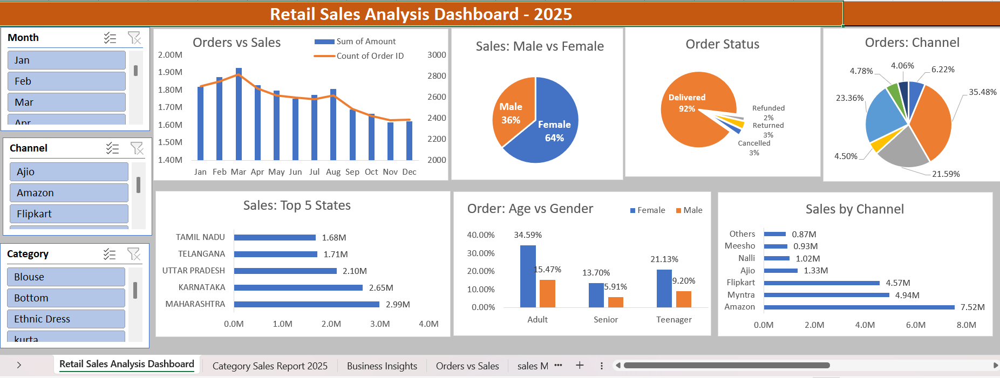

# Retail Sales Analysis Dashboard - 2025

An interactive retail sales dashboard built using Microsoft Excel to analyze sales performance, product categories, customer demographics, order status, and sales channels.

## Dashboard Preview

## Key Analysis
- Monthly Sales and Order Trends
- Sales by Gender
- Order Status Analysis
- Orders by Sales Channel
- Top 5 States by Sales
- Age Group and Gender Analysis

## Tools Used
- Microsoft Excel
- Pivot Tables and Pivot Charts
- Slicers for Interactive Filtering
- Data Analysis and Visualization

## Project File

[Download Excel Dashboard](Retail_Sales_Analysis_Dashboard_2025.xlsx)
